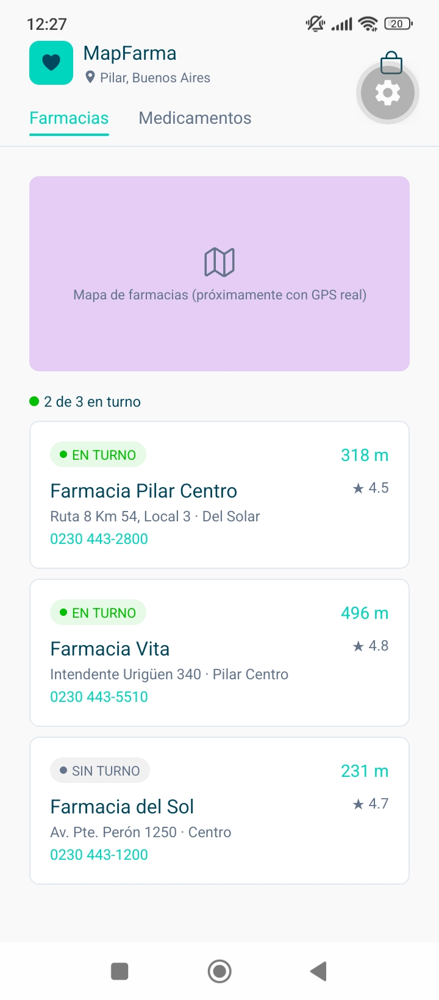
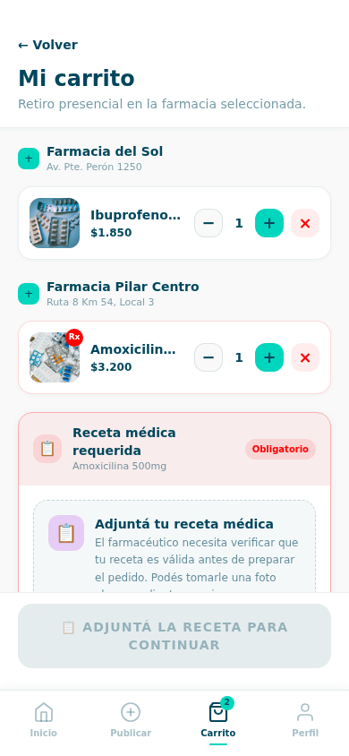
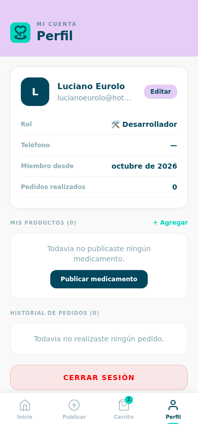

# MapFarma 💊📍

[](https://github.com/sonny5134/mapfarma/actions/workflows/test.yml)

Aplicación móvil que usa el GPS del celular para mostrar las **farmacias de turno en Pilar, Buenos Aires**, ordenadas por distancia real, con un **carrito de compras** para encargar medicamentos y retirarlos de forma presencial en la farmacia elegida.

> **El problema:** encontrar una farmacia de turno abierta y saber si tiene el medicamento que necesitás obliga a llamar o recorrer. MapFarma muestra todo en un solo lugar: qué farmacia está de turno, qué tan lejos está y qué stock tiene.

## Capturas

| Inicio | Medicamentos | Carrito | Perfil |
|---|---|---|---|
|  |  |  |  |

## Descargar la app (Android)

📲 **[Descargar MapFarma (.apk)](REEMPLAZAR_CON_EL_LINK_DEL_BUILD)**

1. Abrí el link desde tu celular Android (o escaneá el QR de la página del build).
2. Descargá el archivo `.apk`.
3. Al abrirlo, Android te va a pedir permiso para **instalar apps de orígenes desconocidos**: aceptalo solo para este archivo.
4. Abrí MapFarma, registrate con un email y listo.

## Integrantes

- Sonny Francisco López Villanueva — Desarrollador
- Luciano Federico Eurolo — Desarrollador
- Facundo Valentín Torrente — Desarrollador
- Francesco Paolo Villarroel Galarza — Desarrollador
- Martín Javier Muñoz Ayala — Desarrollador
- Gustavo Ezequiel Zapata — Desarrollador

## Funcionalidades

- **Autenticación real** con Firebase Authentication (email y contraseña), sesión persistente y redirección automática según la sesión (Auth Guard).
- **Farmacias en tiempo real** con Firestore (`onSnapshot`): si cambia un dato en la base, la app se actualiza sola.
- **GPS real:** calcula la distancia a cada farmacia (fórmula de Haversine) y las reordena de la más cercana a la más lejana.
- **Catálogo de medicamentos** con búsqueda, filtro por categoría y detalle.
- **Carrito y checkout** con manejo de medicamentos que requieren receta (foto con cámara o galería).
- **CRUD completo:** publicar, editar y eliminar medicamentos propios, con formularios validados (React Hook Form + Zod).
- **Seguridad:** Firestore Security Rules por usuario: solo el dueño de un producto puede editarlo o borrarlo.
- **Rendimiento y UX:** listas con FlashList, componentes memoizados, Swipe-to-Delete animado y accesibilidad (`accessibilityLabel` / `accessibilityRole`).

## Stack y dependencias

| Área | Tecnología |
|---|---|
| Framework | Expo SDK 57 + React Native 0.86 + TypeScript |
| Navegación | Expo Router (file-based routing, grupos `(tabs)` y `(auth)`) |
| Backend | Firebase Authentication + Cloud Firestore |
| Estado global | Context API (`UserContext`, `CartContext`) |
| Formularios | React Hook Form + Zod |
| Listas | `@shopify/flash-list` |
| Animaciones | `react-native-reanimated` + `react-native-gesture-handler` |
| Hardware | `expo-location`, `expo-image-picker`, `expo-secure-store` |
| Feedback | `react-native-toast-message` |
| Testing | Jest (`jest-expo`) + React Native Testing Library |
| Build y CI | EAS Build + GitHub Actions |

## Cómo correr el proyecto en desarrollo

```bash
git clone https://github.com/sonny5134/mapfarma.git
cd mapfarma
npm install
```

Creá un archivo `.env` en la raíz con las credenciales de tu proyecto de Firebase (este archivo **no** se sube a GitHub):

```
EXPO_PUBLIC_FB_API_KEY=...
EXPO_PUBLIC_FB_AUTH_DOMAIN=...
EXPO_PUBLIC_FB_PROJECT_ID=...
EXPO_PUBLIC_FB_STORAGE_BUCKET=...
EXPO_PUBLIC_FB_MSG_SENDER_ID=...
EXPO_PUBLIC_FB_APP_ID=...
```

```bash
npx expo start
```

Escaneá el QR con **Expo Go** para verlo en tu celular.

## Tests

```bash
npm test
```

Los tests corren automáticamente en cada Pull Request con GitHub Actions (ver el badge de arriba).

## Generar el build (EAS)

```bash
npm install -g eas-cli
eas login
eas build --platform android --profile preview   # genera el .apk instalable
```

Los perfiles `development`, `preview` y `production` están definidos en `eas.json`.

## Decisiones técnicas

- **Firebase (Auth + Firestore):** sincronización en tiempo real con `onSnapshot` y sin servidor propio. Las Security Rules garantizan que solo el dueño de un producto (`userId` = UID de Firebase) pueda editarlo o borrarlo.
- **Context API en vez de Zustand:** el estado global es chico (sesión y carrito) y Context alcanza sin agregar una dependencia. Para que no provoque renders de más, las funciones del carrito tienen referencia estable (`useCallback`) y las tarjetas de las listas usan `React.memo`.
- **Capa de servicios + hooks:** las pantallas no conocen Firebase. Hablan con hooks (`useMedicamentos`, `useFarmacias`) que usan servicios (`firestoreMedicamentos`, `authService`), así que cambiar de backend no obliga a tocar la interfaz.
- **Backend intercambiable (arquitectura agnóstica):** las pantallas hablan con hooks y los hooks con servicios que cumplen un contrato (`services/contratos.ts`); solo los archivos de servicio importan Firebase. Para comprobarlo hay una segunda implementación que consume una API REST con Axios (`services/restMedicamentos.ts` + `services/api.ts`): cambiando una sola línea de importación en `hooks/useMedicamentos.ts`, la Home muestra datos de la API sin modificar nada de la interfaz. Los interceptores de Axios adjuntan el token de sesión solo a nuestra propia API, nunca a servicios de terceros.
- **GPS en lugar de Firebase Storage:** desde 2026 Cloud Storage for Firebase exige una cuenta de facturación (plan Blaze). Para no depender de una tarjeta de crédito, la característica de hardware es la ubicación real, que además es el núcleo de la app.
- **EAS Build:** el `.apk` se compila en la nube y las credenciales de Firebase viajan como variables de entorno de EAS, nunca en el repositorio.

## Desarrollo asistido por IA

Usamos **Claude (Anthropic)** como programador de apoyo (*pair programming*) durante todo el cuatrimestre. Nuestro método: pegarle el error exacto junto con el stack (Expo SDK 57, React Native 0.86, Firebase, TypeScript) y pedirle primero la **causa raíz** y recién después el código. Todo lo que propuso lo validamos con `npx tsc --noEmit`, con los tests y probando en un celular real.

### Desafíos que resolvimos con ayuda de la IA

| Desafío | Qué se resolvió |
|---|---|
| **Salir de `mockData`** | Diseñar la capa de servicios y los hooks con `onSnapshot`, y rehacer el carrito para guardar el medicamento completo (antes buscaba por ID en un mock que dejó de existir). |
| **Sesión y Auth Guard** | Evitar una condición de carrera entre el registro y `onAuthStateChanged`, y no montar ninguna pantalla hasta restaurar la sesión, para que Firestore no reciba pedidos sin autenticar. |
| **Security Rules** | Pasar la propiedad de un producto del email al UID de Firebase y escribir reglas que impiden que un usuario edite o borre productos ajenos. Lo comprobamos con dos usuarios. |
| **Tipos de formularios** | Resolver el error de TypeScript entre `z.coerce.number()` y React Hook Form usando `useForm<Entrada, any, Salida>`. |
| **Rendimiento (60 fps)** | Memoizar tarjetas, estabilizar funciones con `useCallback` y migrar las listas a FlashList v2. |
| **Animación** | Swipe-to-Delete con Reanimated 4 y Gesture Handler, usando `scheduleOnRN` (reemplaza a `runOnJS`) y pidiendo confirmación antes de borrar en Firestore. |
| **Navegación** | Detectar por qué no aparecía la barra de pestañas (faltaba `_layout.tsx`) y por qué el header del detalle estaba oculto (`headerShown` heredado del layout raíz). |
| **Tooling y entorno** | Disco lleno (`ENOSPC`), conflictos de dependencias (`ERESOLVE`), configuración de Jest con `jest-expo` y Testing Library v14 (API asíncrona), y variables de entorno en EAS. |

### Dónde la IA se equivocó y cómo lo detectamos

Usar IA no es copiar y pegar. Algunos errores que aparecieron y cómo se encontraron:

- Escribió tests con la API de Testing Library v13 y fallaban con la v14 (que es asíncrona): lo detectó `npm test`.
- Usó `StyleSheet.absoluteFillObject`, que ya no existe en React Native 0.86, y dejó un `index.ts` viejo que importaba un archivo borrado: los detectó `tsc`.
- Generó el ícono de la app con el símbolo demasiado chico, porque no recortó el margen transparente de la imagen: lo detectamos mirando el resultado en el celular.
- Propuso Firebase Storage para subir fotos, pero ya no es gratuito: lo descartamos al verificar la documentación y elegimos GPS.

## Desarrollo guiado por especificaciones (SDD)

Adoptamos **Spec-Driven Development** con la estructura de GitHub Spec Kit: primero se escribe *qué* y *por qué*, y recién después el código.

- `.specify/memory/constitution.md`: principios no negociables del proyecto (stack, arquitectura en capas, seguridad, calidad, diseño).
- `specs/001-imagenes-medicamentos/`: primera funcionalidad documentada con el flujo completo `spec.md` → `plan.md` → `tasks.md`.

Flujo de trabajo: `/speckit.constitution` → `/speckit.specify` → `/speckit.plan` → `/speckit.tasks` → `/speckit.implement`. La IA propone; el equipo valida con `tsc`, tests y prueba en celular real.

## Estructura de carpetas

```
mapfarma/
├── app/                    # Pantallas (cada archivo es una ruta)
│   ├── _layout.tsx         # Layout raíz + Auth Guard
│   ├── (auth)/             # login y registro
│   ├── (tabs)/             # Inicio, Publicar, Carrito, Perfil
│   ├── medicamento/[id].tsx
│   ├── editar/[id].tsx
│   └── checkout.tsx
├── components/             # Componentes reutilizables (cards, InputField, etc.)
├── contexts/               # Estado global (usuario y carrito)
├── hooks/                  # Hooks personalizados (Firestore, GPS, permisos)
├── services/               # Capa de acceso a Firebase y SecureStore
├── schemas/                # Validaciones con Zod
├── constants/theme.ts      # Colores, tipografía y espaciados
├── types/                  # Interfaces de TypeScript
├── utils/                  # Funciones auxiliares (distancia)
└── __tests__/              # Tests con Jest y Testing Library
```

## Paleta de colores

| Color | Hex | Uso |
|---|---|---|
| Primario | `#01475D` | Headers, botones principales, textos |
| Secundario | `#00D6BD` | Acentos, badges, precios |
| Fondo tarjetas | `#E5CDF5` | Tarjetas e imágenes de producto |
| Fondo app | `#F9F9F9` | Fondo general |
| Confirmaciones | `#00BF00` | Estados positivos |
| Errores | `#FF0000` | Errores y sin stock |
